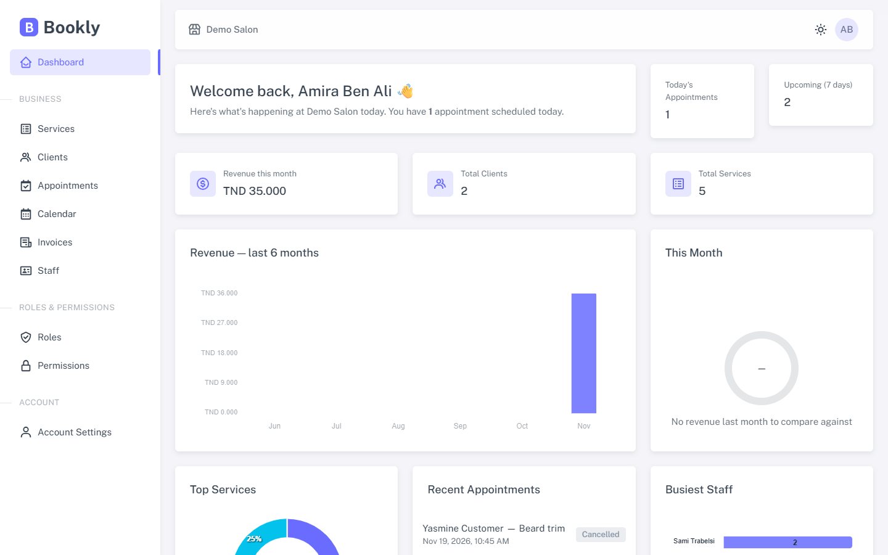
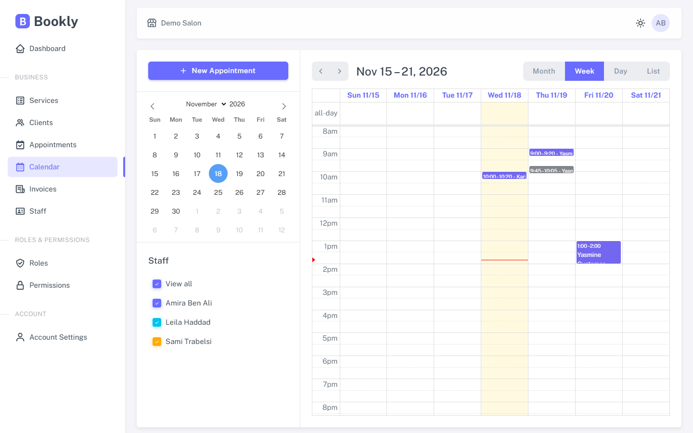
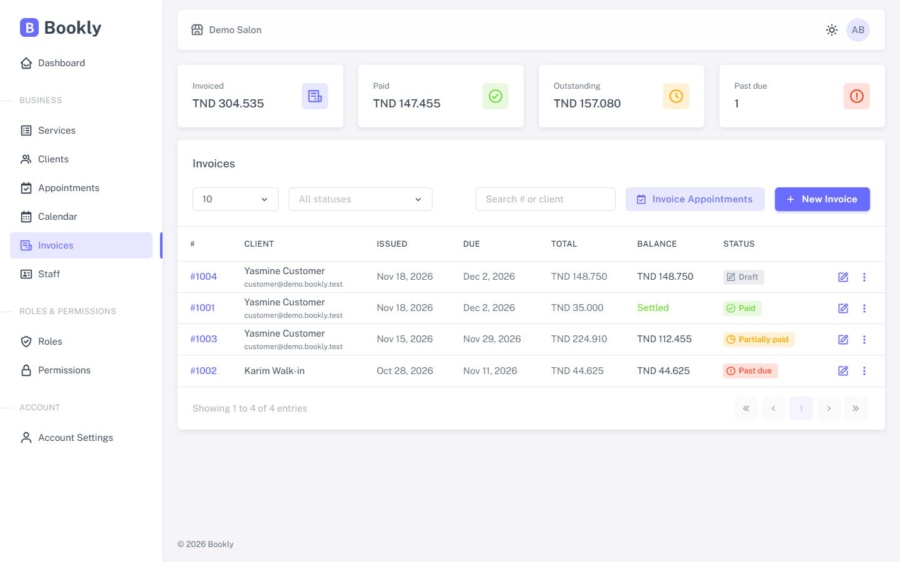
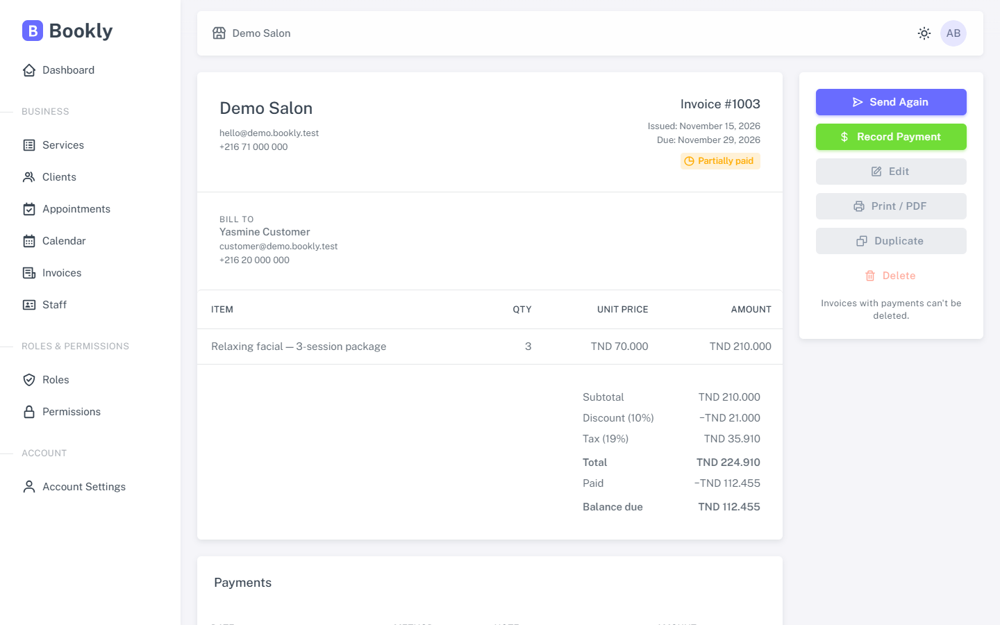
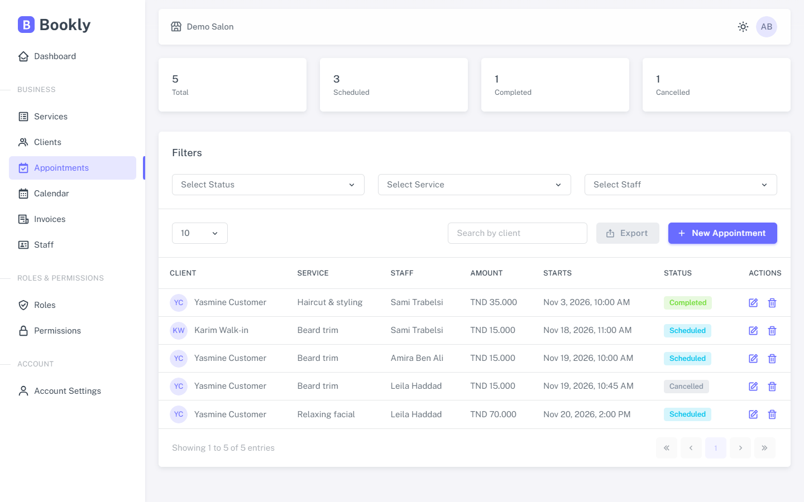

# Bookly — Back office

The staff app of **Bookly**, a multi-tenant booking and business-management SaaS. Businesses run their day here: calendar, appointments, clients, services, invoices, staff and roles.

**Stack:** Vue 3 · TypeScript · Vite · Vuetify 3 · Pinia · Axios · FullCalendar · ApexCharts
**Related:** [API (Laravel)](https://github.com/ghofrane-soulmi/Bookly_backend) · [Front office (customer booking)](https://github.com/ghofrane-soulmi/Bookly_frontoffice)

> **Live demo:** _add your Vercel URL here after deploying_. Log in as `owner@demo.bookly.test` / `123456789`.



## Features

- **Dashboard**: today's and upcoming appointments, monthly revenue, revenue trend, top services, busiest staff, recent activity.
- **Calendar and appointments**: week, day, month and list views, filtering by staff, server-side conflict detection, opening-hours checks, booking emails.
- **Invoices**:
  - Create invoices from scratch or straight from completed appointments.
  - Discount and tax.
  - Record payments, which move an invoice through draft, sent, partially paid, paid or past due.
  - Email to the client, print or save as PDF, duplicate.
- **Clients and services**: CRUD with search, pagination and CSV export. Client detail pages show visit history and total spent.
- **Staff, roles and permissions**: custom roles per business. The menu, pages and buttons adapt to the signed-in user's permissions, and the API enforces the same rules.
- **Resilient UX**:
  - A route progress bar while pages load.
  - Automatic recovery when a page's code fails to load after a deploy.
  - Error states with Retry instead of endless spinners.
  - Token refresh shared across simultaneous requests.
  - Light and dark themes, mobile layout.

| Calendar | Invoices |
|---|---|
|  |  |
| **Invoice** | **Appointments** |
|  |  |

## Run locally

Start the [API](https://github.com/ghofrane-soulmi/Bookly_backend) first, then:

```bash
cp .env.example .env   # VITE_API_BASE_URL=http://localhost:8000/api
npm install
npm run dev            # http://localhost:5173
```

Other scripts: `npm run build`, `npm run typecheck`, `npm run lint`.

## Deploy

Static Vite build on Vercel. `vercel.json` adds the rewrite that makes deep links work. Set `VITE_API_BASE_URL` to the deployed API.

## Credits

The UI started from the free [Sneat Vuetify admin template](https://github.com/themeselection/sneat-vuetify-vuejs-admin-template-free) (MIT). The application pages, API integration and features are Bookly's own.
